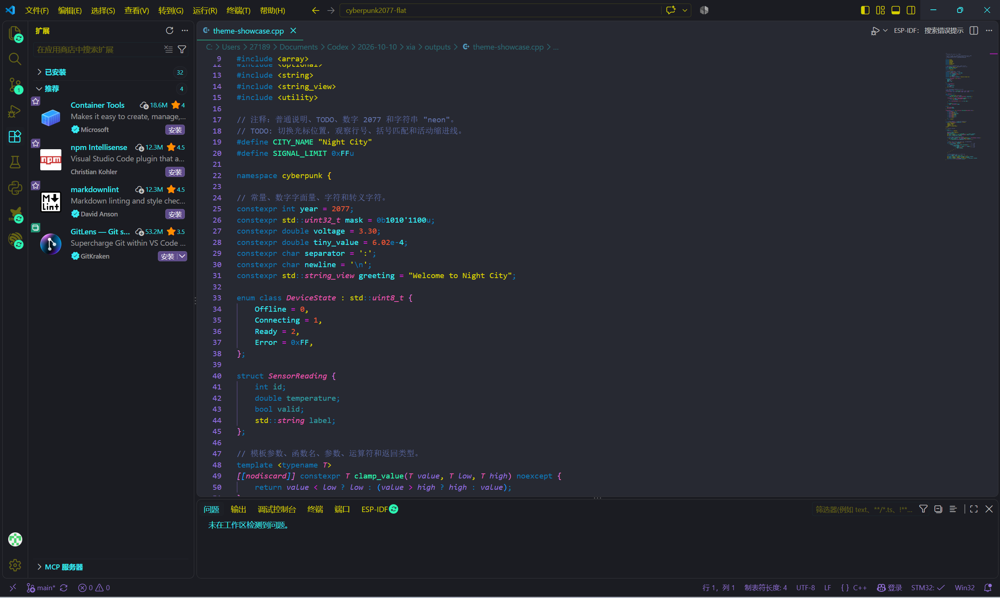

# Cyberpunk 2077 (Custom)

A softer take on the Cyberpunk 2077 VS Code theme, with dimmer yellow text and a dark status bar with purple text.

基于 Cyberpunk 2077 的 VS Code 自定义主题：降低黄色字体明度，搭配灰黑色底栏和紫色文字，让整体视觉更柔和、统一。

Fork of [jwsandeman/cyberpunk2077-theme](https://github.com/jwsandeman/cyberpunk2077-theme), inspired by CD Projekt RED’s Cyberpunk 2077.

## Preview / 效果预览



## What changed / 改动说明

### Softer yellow text / 降低黄色字体明度

The original bright yellow `#FDF500` is replaced with `#D7D000`. Yellow text keeps the theme’s cyberpunk character while reducing its fluorescent intensity. Existing transparency is preserved for translucent variants.

将原本明亮的黄色 `#FDF500` 调整为 `#D7D000`，保留赛博朋克配色的辨识度，同时减弱荧光感。半透明颜色变体保留原有透明度。

### Dark status bar, purple text / 灰黑底栏、紫色文字

The status bar uses a dark gray background (`#1B1C22`) and purple text (`#9370DB`), matching the normal editor line numbers. This brings the bottom bar into the same visual palette as the rest of the interface.

底部状态栏改为灰黑背景（`#1B1C22`），文字和图标采用与普通代码行号一致的紫色（`#9370DB`），使底栏与整体界面更加协调。

### Six levels of indentation guides / 六级缩进参考线

Indentation guides use six shades of the same purple, becoming more subtle at deeper levels. The active guide is brighter, making the current block easier to follow. The six-color palette repeats beyond level six.

缩进参考线采用六级紫色渐变，层级越深越淡；光标所在层的参考线会加亮，方便辨认当前代码块。超过六级后循环使用这组配色。

## Installation / 安装

Clone this fork into your VS Code extensions directory:

将此 fork 克隆到 VS Code 扩展目录：

```sh
git clone https://github.com/Swirlxx756/cyberpunk2077-flat.git ~/.vscode/extensions/swirlxx756.cyberpunk2077-theme
```

On Windows PowerShell / Windows PowerShell 下使用：

```powershell
git clone https://github.com/Swirlxx756/cyberpunk2077-flat.git "$env:USERPROFILE\.vscode\extensions\swirlxx756.cyberpunk2077-theme"
```

1. Run **Developer: Reload Window** in the Command Palette.
2. Run **Preferences: Color Theme** and select **cyberpunk2077-custom**.

1. 在命令面板执行 **开发人员: 重新加载窗口**。
2. 执行 **首选项: 颜色主题**，选择 **cyberpunk2077-custom**。

This is a declarative theme extension; no build step is required. If the target directory already contains this fork, run `git pull` inside it instead of cloning again, then reload VS Code.

这是声明式主题扩展，无需构建。如果目标目录已安装此 fork，请在该目录中运行 `git pull` 更新，然后重新加载 VS Code。

### Enable indentation guides / 启用缩进参考线

Add these settings if indentation guides are disabled:

如果缩进参考线未开启，可在设置 JSON 中加入：

```jsonc
"editor.guides.indentation": true,
"editor.guides.highlightActiveIndentation": true
```

**Color overrides / 颜色覆盖：** Values in `workbench.colorCustomizations` take precedence over the theme. Remove existing `statusBar.*` overrides if you want the status bar to follow this theme. Some extension-provided status items may specify their own colors.

`workbench.colorCustomizations` 中的设置会覆盖主题颜色。如果希望底栏跟随本主题，请移除已有的 `statusBar.*` 颜色覆盖。部分扩展提供的状态项可能使用自己的颜色。

## Original previews / 上游原版截图

<details>
<summary>Show original theme screenshots / 展开上游原版截图</summary>

These screenshots show the upstream theme before this fork’s changes.

以下截图展示上游原版主题，不代表此 fork 修改后的效果。


</details>

## Acknowledgements / 致谢

- [Original theme by JW Sandeman / JW Sandeman 的原版主题](https://github.com/jwsandeman/cyberpunk2077-theme)
- [codeSTACKr](https://www.youtube.com/watch?v=QCqWzb-9Sy8)
- [Coder Coder](https://www.youtube.com/watch?v=pGzssFNtWXw)
- [VS Code theme colour generator — Coder Coder](https://coder-coder.com/vs-code-theme-color-generator/)
- [Dracula Official Theme](https://draculatheme.com/visual-studio-code)
- [Cyberpunk 2077 colour palette — cdixon13](https://www.deviantart.com/cdixon13/art/CyberPunk-2077-Palette-879017278)
- [Colour palette generator — Coolors](https://coolors.co/)

## Feedback / 问题反馈

For issues with this custom fork, please [open an issue](https://github.com/Swirlxx756/cyberpunk2077-flat/issues).

如果遇到此自定义 fork 的问题，请在仓库中[提交 issue](https://github.com/Swirlxx756/cyberpunk2077-flat/issues)。
